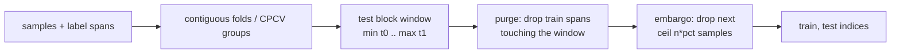

<div align="center">


# purged-cv

**Leak-free cross-validation for financial machine learning: purged K-fold, embargo, CPCV and purged walk-forward.**

_Built and maintained by [Viprasol Tech](https://viprasol.com) — Fintech Experts. Full-Stack Builders._

[](https://github.com/Viprasol-Tech/purged-cv/actions/workflows/ci.yml)
[](LICENSE)
[](https://www.python.org/)
[](pyproject.toml)
[](https://github.com/astral-sh/ruff)
[](https://t.me/viprasol_help)

</div>

---

If your label is "the return over the next 10 bars", plain K-fold leaks. Training
samples right next to the test fold share future prices with it, so the model is
graded on data it has partly seen. The result is cross-validation scores that look
great and fall apart live.

`purged-cv` fixes this. It drops ("purges") every training sample whose label
overlaps the test fold. It also adds an **embargo** after each test fold and gives
you **Combinatorial Purged CV** to get many backtest paths instead of one. Every
splitter speaks the scikit-learn CV protocol, and the library has **zero dependencies**.

> ## ⚠️ Disclaimer
> This software is for **educational and research purposes only** and is **not financial advice**. Leak-free validation removes one source of false confidence; it does not make a strategy profitable. Use at your own risk. Viprasol Tech is not affiliated with any third party referenced here.

## ✨ Features

- 🧹 **`PurgedKFold`**: contiguous K-fold that purges overlapping labels, with an `embargo_pct` after each test fold.
- 🔀 **`CombinatorialPurgedKFold` (CPCV)**: all `C(N, k)` splits, plus `n_paths` and `paths()` to stitch full out-of-sample backtest paths.
- ⏩ **`PurgedWalkForward`**: expanding or rolling (`max_train_size`) walk-forward, purged before each test block.
- 🏷️ **Label spans or horizon**: pass `horizon=10` for fixed look-ahead labels, or your own `(t0, t1)` spans for triple-barrier and event labels.
- 🔍 **`find_leaks`** audits *any* train/test split, including ones from other libraries, and lists every overlapping pair.
- 🤝 **scikit-learn compatible**: works as `cv=` in `cross_val_score`, `GridSearchCV` and `RandomizedSearchCV`.
- 📊 **`purgedcv plan` CLI** draws every split as a lane (`T` test, `=` train, `.` purged) and fails if anything leaks.
- 🎯 **Matches sklearn exactly** when labels do not overlap (`KFold`, `TimeSeriesSplit`), which is checked in the tests.
- 🔒 Typed (`mypy --strict`), tested, pure standard library.

## 🚀 Quickstart

```bash
git clone https://github.com/Viprasol-Tech/purged-cv.git
cd purged-cv
pip install -e .

purgedcv plan --samples 60 --splits 5 --horizon 3 --embargo 0.02
python examples/quickstart.py
```

`purgedcv plan` output:

```text
kfold: 60 samples, horizon=3, embargo=0.02
legend: T test  = train  . purged/embargoed

  0 |TTTTTTTTTTTT.....===========================================| train=43 test=12 dropped=5
  1 |=========...TTTTTTTTTTTT.....===============================| train=40 test=12 dropped=8
  2 |=====================...TTTTTTTTTTTT.....===================| train=40 test=12 dropped=8
  3 |=================================...TTTTTTTTTTTT.....=======| train=40 test=12 dropped=8
  4 |=============================================...TTTTTTTTTTTT| train=45 test=12 dropped=3

leaking train/test pairs: 0
```

`examples/quickstart.py` shows the leak naive K-fold hides:

```text
naive 5-fold leaking pairs:  440
purged 5-fold leaking pairs: 0
CPCV(6, 2): 15 splits -> 5 backtest paths
path 0 uses (group, split): [(0, 0), (1, 0), (2, 1), (3, 2), (4, 3), (5, 4)]
```

## 🧑‍💻 Usage

### With scikit-learn

```python
from sklearn.linear_model import LogisticRegression
from sklearn.model_selection import cross_val_score
from purged_cv import PurgedKFold

X = [[(i % 7) / 7] for i in range(300)]
y = [int(i % 7 > 3) for i in range(300)]
cv = PurgedKFold(n_splits=5, horizon=10, embargo_pct=0.01)
print(cross_val_score(LogisticRegression(), X, y, cv=cv))  # 5 fold scores
```

### Event labels (triple barrier, variable holding periods)

```python
from datetime import datetime
from purged_cv import PurgedKFold

events = [  # (entry time, exit time) for each labelled trade, sorted by entry
    (datetime(2026, 1, 2, 9, 30), datetime(2026, 1, 2, 11, 0)),
    (datetime(2026, 1, 2, 10, 0), datetime(2026, 1, 2, 15, 30)),
    # ...
]
spans = [(a.timestamp(), b.timestamp()) for a, b in events]
cv = PurgedKFold(n_splits=5, spans=spans, embargo_pct=0.01)
```

### CPCV backtest paths

```python
from purged_cv import CombinatorialPurgedKFold

cpcv = CombinatorialPurgedKFold(n_groups=6, n_test_groups=2, horizon=10, embargo_pct=0.01)
splits = list(cpcv.split(X))          # 15 (train, test) index lists
for path in cpcv.paths():             # 5 paths
    ...  # for each (group, split) pair, take split's predictions on that group
```

### Audit an existing split

```python
from purged_cv import find_leaks, horizon_spans

leaks = find_leaks(train_idx, test_idx, horizon_spans(len(X), 10))
assert not leaks, f"{len(leaks)} overlapping train/test labels"
```

### CLI reference

```text
purgedcv plan [--method kfold|cpcv|walkforward] [--samples N] [--splits K]
              [--groups N] [--test-groups k] [--horizon H] [--embargo PCT]
              [--max-train W]
```

The command exits `0` when the plan is clean, `1` if any pair leaks and `2` on bad input.

## 🏗️ How it works



Details, with the reasoning behind each rule, are in [docs/how-it-works.md](docs/how-it-works.md).

## 🗺️ Roadmap

- [x] Purged K-fold with embargo
- [x] Combinatorial purged CV with backtest paths
- [x] Purged walk-forward (expanding and rolling)
- [x] Leak auditor and CLI
- [ ] Optional pandas `Series` input for spans
- [ ] Path-level performance helper (Sharpe distribution across CPCV paths)

## 🤝 Contributing

Pull requests are welcome. See [CONTRIBUTING.md](CONTRIBUTING.md) for the dev
setup and the checks CI runs.

## 📬 Contact — Viprasol Tech Private Limited

- 🌐 Website: [viprasol.com](https://viprasol.com)
- ✉️ Email: [support@viprasol.com](mailto:support@viprasol.com)
- 💬 Telegram: [t.me/viprasol_help](https://t.me/viprasol_help) · 📱 WhatsApp: +91 96336 52112
- 🐙 GitHub: [@Viprasol-Tech](https://github.com/Viprasol-Tech) · 💼 [LinkedIn](https://www.linkedin.com/in/viprasol/) · 𝕏 [@viprasol](https://twitter.com/viprasol)

> *Viprasol Tech — fintech software, algorithmic trading systems, MT4/MT5 bots,
> AI voice agents, and B2B SaaS. Need a custom build? [Get in touch](mailto:support@viprasol.com).*

## 📄 License

[MIT](LICENSE) © 2025 Viprasol Tech Private Limited.
